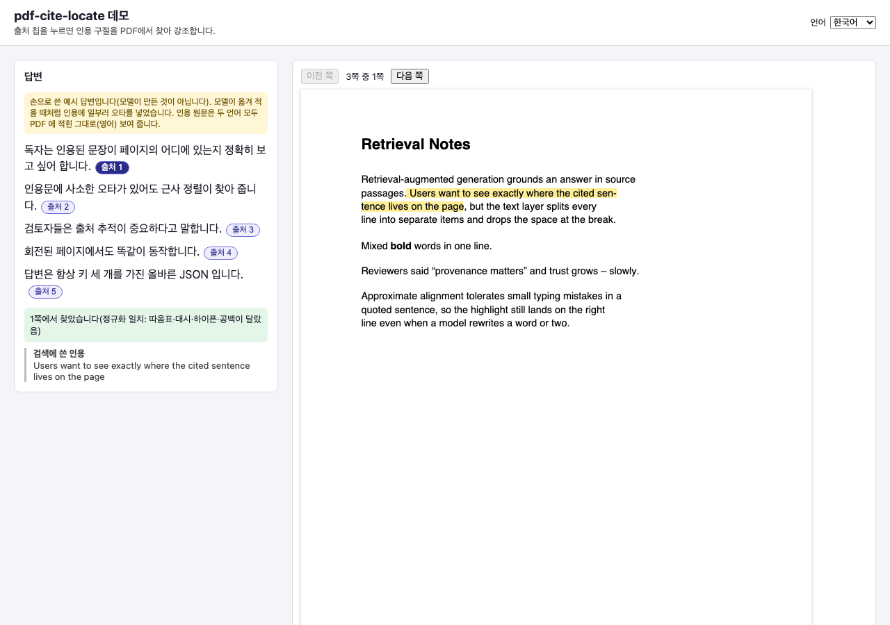
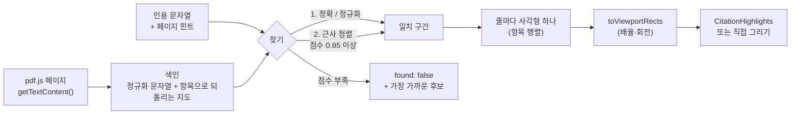
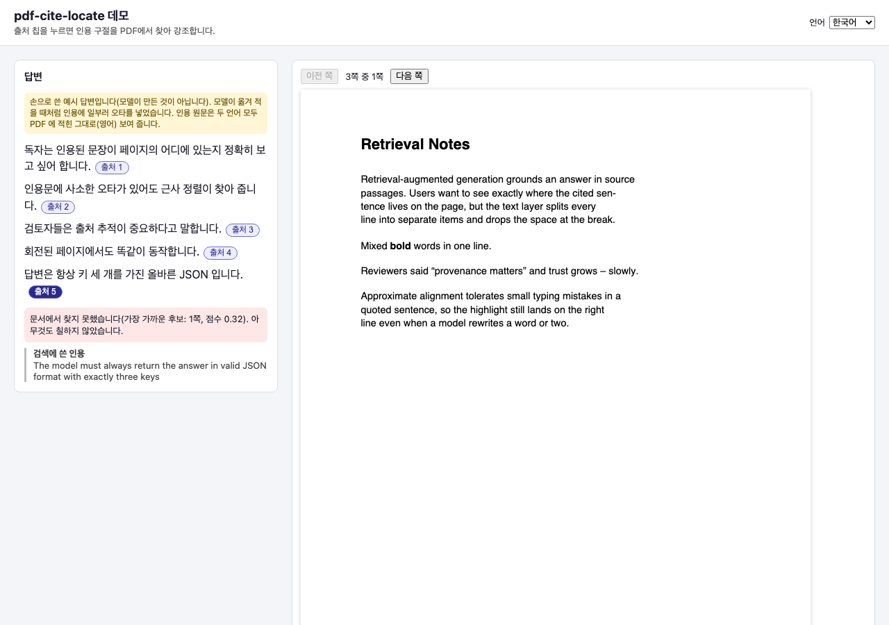
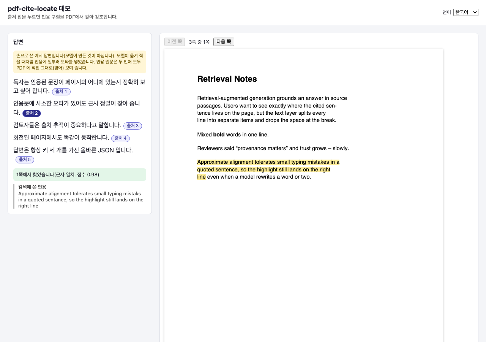
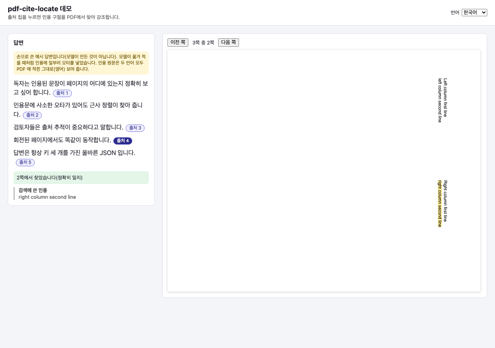
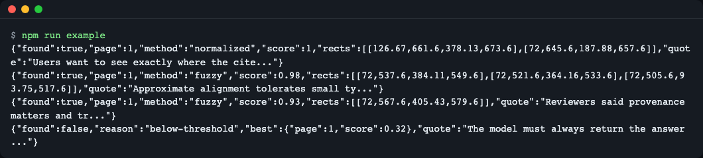

# pdf-cite-locate

[English](README.md) | **한국어**

RAG 답변이 돌려준 인용 문자열을 pdf.js 페이지 안에서 찾아 강조용 사각형으로 돌려줍니다. 줄 끝 하이픈·곡선 따옴표·작은 오타를 견디고, 점수를 알려 주며, 엉뚱한 곳을 칠하는 대신 "못 찾음"이라고 말합니다. TypeScript, ESM, 런타임 의존성 0개이고 `pdfjs-dist` 를 import 하지 않으므로 뷰어가 이미 쓰는 pdf.js 버전과 그대로 함께 씁니다.



*웹 예제: "출처 1"을 누르면 하이픈으로 끊긴 줄바꿈을 넘어 인용 문장이 PDF 위에 강조됩니다.*

## 왜 필요한가

RAG 답변은 "근거: 3쪽의 이 문장"처럼 문자열을 돌려줍니다. 그런데 PDF 뷰어(pdf.js)는 페이지를 문자열 하나로 들고 있지 않습니다. `page.getTextContent()` 는 줄이나 글꼴 단위의 작은 텍스트 항목을 여러 개 돌려주고, 줄바꿈은 글자가 아니라 `hasEOL` 표시로만 있습니다. 샘플 PDF 1쪽의 첫 항목들입니다(실제 출력).

```text
{"str":"Retrieval Notes","x":72,"y":720,"hasEOL":false}
{"str":"","x":72,"y":680,"hasEOL":true}
{"str":"Retrieval-augmented generation grounds an answer in source","x":72,"y":680,"hasEOL":true}
{"str":"passages. Users want to see exactly where the cited sen-","x":72,"y":664,"hasEOL":true}
{"str":"tence lives on the page, but the text layer splits every","x":72,"y":648,"hasEOL":true}
```

인용 `"the cited sentence lives on the page"` 를 단순 `includes()` 로 찾으면 실패합니다. 문장이 `sen-` 과 `tence` 로 갈라져 있고 줄바꿈 자리에 공백이 없기 때문입니다. 모델이 인용을 옮겨 적으면서 따옴표를 바꾸거나 오타를 낼 수도 있습니다. 이 라이브러리는 항목을 이어 붙이고, 정확 일치 → 정규화 일치 → 근사 일치 순으로 찾은 뒤, 찾은 구간을 원래 항목으로 되돌려 줄마다 사각형 하나를 줍니다.

## 설치

```bash
npm install pdf-cite-locate
# 또는 GitHub 에서 바로
npm install github:LeeGyeongPil/pdf-cite-locate
```

Node 에서 쓰려면 Node 22.13 이상이 필요합니다(pdf.js 6 의 요구 사항). 런타임 의존성은 없습니다. `react`(18 이상)는 `pdf-cite-locate/react` 를 쓸 때만 필요한 선택 peer 의존성입니다. pdf.js 는 직접 가져옵니다(`pdfjs-dist` 또는 `react-pdf` 가 설치하는 것).

## 빠르게 시작하기

Node, pdf.js legacy 빌드 사용(`examples/node/locate.mjs` 를 줄인 것):
> `fixtures/citations.pdf` 는 GitHub 레포에만 있고 npm 패키지에는 들어 있지 않습니다. 레포를 clone 하거나 경로를 가지고 있는 PDF 로 바꿔 실행하세요.


```js
import { readFileSync } from "node:fs";
import * as pdfjs from "pdfjs-dist/legacy/build/pdf.mjs";
import { createLocator, toViewportRects } from "pdf-cite-locate";

const doc = await pdfjs.getDocument({
  data: new Uint8Array(readFileSync("fixtures/citations.pdf")),
  standardFontDataUrl: "node_modules/pdfjs-dist/standard_fonts/", // Node 의 글꼴 경고를 없앱니다
}).promise;

const locator = createLocator(doc);
const result = await locator.locate("Approximate alignment tolerates small typing mistaks in a quoted sentance", { pageHint: 1 });

if (result.found) {
  console.log(result.page, result.method, result.score.toFixed(2), result.approx);
  const page = await doc.getPage(result.page);
  console.log(toViewportRects(result.rects, page.getViewport({ scale: 1.5 })));
}
```

인용에는 일부러 오타 두 개("mistaks", "sentance")를 넣었습니다. 이 코드의 실제 출력입니다.

```text
1 fuzzy 0.97 true
[
  {
    left: 108,
    top: 363.5999999999999,
    width: 468.16200000000026,
    height: 18
  },
  {
    left: 108,
    top: 387.5999999999999,
    width: 113.3394827586207,
    height: 18
  }
]
```

`approx: true` 는 x 위치를 글자 수로 추정했다는 뜻입니다. [정밀도](#정밀도)를 보세요.

브라우저, react-pdf 사용(전체 코드는 `examples/web/src/App.tsx`):

```tsx
import { Document, Page } from "react-pdf";
import { createLocator } from "pdf-cite-locate";
import { CitationHighlights } from "pdf-cite-locate/react";

// <Document onLoadSuccess={(pdf) => { locator = createLocator(pdf); }}> ... 그 뒤 클릭할 때:
const result = await locator.locate(quote, { pageHint: 1 });

<Page pageNumber={page} onLoadSuccess={(p) => setViewport(p.getViewport({ scale }))}>
  {viewport && result.found && <CitationHighlights rects={result.rects} viewport={viewport} page={page} />}
</Page>
```

## 동작 원리



1. **색인.** 텍스트 항목을 글자 단위로 정규화합니다(유니코드 NFKC, 곡선 따옴표·대시 통일, 소프트 하이픈·폭 없는 글자 제거, 공백 축약, 대소문자 접기). `hasEOL` 로 끝나는 줄은 공백 한 칸이 되지만, `sen-` + `tence` 는 하이픈을 지우고 `sentence` 로 이어 붙입니다. 정규화된 글자마다 어느 항목의 몇 번째 글자에서 왔는지 기억해 둡니다.
2. **찾기.** 먼저 정규화 문자열에서 정확히 찾고, 그다음 공백을 모두 무시하고 찾고, 마지막으로 근사 정렬(Sellers 편집 거리, 3-gram 투표로 후보 창 몇 개만 골라 긴 페이지도 빠르게)을 합니다. 점수는 `1 - 편집 거리 / 인용 길이` 입니다. 임계값(기본 0.85) 미만이면 `found: false` 입니다. 12자보다 짧은 인용은 근사 일치를 하지 않습니다.
3. **사각형.** 일치 구간을 항목으로 되돌립니다. 항목의 변환 행렬 `[a, b, c, d, e, f]` 가 기준선 방향과 글자 위쪽 방향을 알려 주므로 회전된 글자도 됩니다. 같은 줄의 항목은 PDF 사용자 좌표(y 가 위쪽)의 사각형 하나로 합칩니다.
4. **뷰포트.** `toViewportRects` 가 뷰포트 변환(배율·회전·y 뒤집기)을 적용해 CSS 픽셀로 돌려줍니다.

페이지는 필요할 때 색인하고 캐시합니다. `pageHint` 가 있으면 그 페이지, 이웃 페이지, 나머지 순으로 찾고, 힌트 페이지에서 정확·정규화 일치가 나오면 다른 페이지는 색인조차 하지 않습니다.

## API

| 이름 | 하는 일 | 인자 | 반환 |
|---|---|---|---|
| `createLocator(doc, opts?)` | pdf.js 문서(`numPages` 와 `getPage(n)` 이 있는 것)를 감쌉니다. 페이지를 필요할 때 색인하고 캐시합니다. | `opts.measure?` `Measurer`, `opts.textContentParams?` `getTextContent` 에 전달 | `Locator` |
| `locator.locate(quote, opts?)` | 인용 하나를 찾습니다. | `opts.pageHint?`, `opts.pages?`, `opts.threshold?`(0.85), `opts.caseSensitive?`(false) | `Promise<LocateResult>` |
| `locator.locateAll(quotes)` | 인용 여러 개를 찾습니다. | `string[]` | `Promise<LocateResult[]>` |
| `locator.indexedPages()` | 지금까지 색인한 페이지 번호. | 없음 | `number[]` |
| `buildPageIndex(textContent, { pageNumber, measure? })` | 한 페이지의 색인을 만듭니다. 텍스트 내용을 이미 가진 경우에 씁니다. | `TextContentLike` | `PageIndex` |
| `locateInIndexes(indexes, quote, opts?)` | 만들어 둔 색인에서 동기로 찾습니다. | `PageIndex[]`, 인용, `LocateOptions` | `LocateResult` |
| `toViewportRects(rects, viewport)` | PDF 사용자 좌표를 CSS 픽셀로 바꿉니다. | `PdfRect[]`, `transform` 배열이 있는 객체(pdf.js `PageViewport`) | `CssRect[]` (`left`, `top`, `width`, `height`) |
| `normalizeText(s)` | 양쪽에 쓰는 정규화. | `string` | `string` |
| `DEFAULT_THRESHOLD`, `MIN_FUZZY_LENGTH`, `BOX_ASCENT`, `BOX_DESCENT`, `VERSION` | 상수: 0.85, 12, 기준선 위·아래 상자 범위(글자 높이 단위), 패키지 버전. | | |
| `<CitationHighlights>` (`pdf-cite-locate/react`) | 한 페이지의 절대 위치 `role="mark"` 상자. 페이지 컨테이너 안에 둡니다(react-pdf 는 `<Page>` 의 자식). | `rects`, `viewport`, `page`, `color?`, `className?`, `label?`, `onSelect?(index)` | React 요소 |
| `createCanvasMeasurer(styles)` (`pdf-cite-locate/dom`) | pdf.js 텍스트 레이어처럼 캔버스로 글자 폭을 재는 `Measurer`. | `textContent.styles` 또는 `undefined` | `Measurer` |
| `LocateError` | 잘못된 입력에서 던집니다. `code` 는 `INVALID_TEXT_CONTENT`, `INVALID_PAGE`, `INVALID_OPTIONS`. | | |

`LocateResult` 는 둘 중 하나입니다.

```ts
{ found: true; page: number; score: number; method: "exact" | "normalized" | "fuzzy";
  matchedText: string; rects: PdfRect[]; approx: boolean }
{ found: false; reason: "below-threshold" | "no-text-layer" | "empty-quote";
  best?: { page: number; score: number; matchedText: string; rects: PdfRect[] } }
```

`PdfRect` 는 PDF 사용자 좌표의 `{ page, x0, y0, x1, y1 }` 입니다.

### 오류 처리

잘못된 입력은 고치는 방법을 알려 주는 메시지와 함께 `LocateError` 를 던집니다. `INVALID_PAGE` 는 `buildPageIndex` 에 1 이상의 정수가 아닌 `pageNumber` 를 줄 때, `createLocator` 에 pdf.js 문서가 아닌 것을 줄 때, `locateInIndexes` 에 `PageIndex` 객체가 아닌 것을 줄 때 발생합니다. `INVALID_OPTIONS` 는 `locateAll` 에 문자열 배열이 아닌 값(문자열 하나, `null`, 숫자 등)을 줄 때 발생합니다. 페이지 텍스트가 인용 길이 × 임계값보다 짧으면 임계값에 닿을 수 없으므로 근사 정렬이 그 페이지를 건너뜁니다. 아주 긴 인용을 짧은 페이지에 대어도 빠르게 끝납니다.

## 정밀도

측정 함수가 없으면 사각형의 시작·끝 x 를 텍스트 항목 안의 글자 수 비례로 추정하고 결과에 `approx: true` 가 붙습니다. 보통 글꼴 크기보다 작은 오차입니다. 브라우저에서는 `createLocator` 에 `createCanvasMeasurer(...)` 를 넘기세요. 그러면 x 위치가 pdf.js 텍스트 레이어와 같은 방식(항목 폭에 맞춰 다시 늘이기)으로 잰 글자 폭에서 나오고 `approx` 는 `false` 입니다. 얼마나 정확한지는 캔버스 글꼴이 PDF 의 글꼴과 같은지에 달려 있습니다. 합자는 pdf.js 가 풀어서 넣으므로 항목의 글자 수가 글리프 수보다 많을 수 있고, 이것이 추정 오차의 원인입니다.

## 못 찾는 것도 기능입니다

임계값을 넘는 후보가 없으면 `found: false` 이고, 있다면 가장 가까운 후보가 `best` 에 들어 있습니다. `best` 를 일치한 것처럼 칠하지 마세요. "문서에서 찾지 못함"을 보여 주고, 원하면 후보를 힌트로 제안하세요. 샘플의 환각 문장이 이렇게 됩니다. `npm run example`(예제 절 참고)은 `score 0.32` 를 보고하고, 웹 예제는 다음처럼 보여 줍니다.



*문서에 없는 인용: 가장 가까운 후보를 알려 주고 아무것도 칠하지 않습니다.*

근사 일치는 여전히 쓸모가 있습니다. 출처 2 는 오타가 두 개인데도 맞는 세 줄에 놓입니다.



*근사 일치: 점수 0.98, 줄 사각형 3개.*

샘플 PDF 의 2쪽은 90도 회전되어 있고 두 단입니다. 뷰포트 변환이 회전을 처리하므로 사각형은 제자리에 놓입니다.



*회전: 강조가 회전된 페이지를 따라갑니다.*

## pdf.js 버전과 함께 쓰기

코어는 pdf.js 객체의 몇 가지 멤버(`numPages`, `getPage`, `getTextContent`, 뷰포트의 `transform`)만 필요로 하고 이를 구조적 타입으로 선언합니다. `pdfjs-dist` 를 import 하지 않으며 peer 의존성도 아닙니다. `react-pdf` 가 자기 `pdfjs-dist` 를 정확한 버전으로 고정하기 때문에, 여기서 의존성으로 걸면 API 와 워커 버전이 어긋난 두 벌이 설치될 수 있습니다. 테스트는 같은 픽스처 검사를 `pdfjs-dist` 6.3.289 와 6.5.438 에서 돌려 같은 페이지·방법·일치 문구를 얻고, `npm run check:no-pdfjs-import` 가 이 규칙을 지킵니다. 웹 예제의 워커는 `react-pdf` 가 쓰는 것과 같은 `pdfjs-dist` 에서 가져옵니다.

## 예제

Node(예: 색인 단계에서 좌표 미리 계산):

```bash
npm run example
```

```text
{"found":true,"page":1,"method":"normalized","score":1,"rects":[[126.67,661.6,378.13,673.6],[72,645.6,187.88,657.6]],"quote":"Users want to see exactly where the cite..."}
{"found":true,"page":1,"method":"fuzzy","score":0.98,"rects":[[72,537.6,384.11,549.6],[72,521.6,364.16,533.6],[72,505.6,93.75,517.6]],"quote":"Approximate alignment tolerates small ty..."}
{"found":true,"page":1,"method":"fuzzy","score":0.93,"rects":[[72,567.6,405.43,579.6]],"quote":"Reviewers said provenance matters and tr..."}
{"found":false,"reason":"below-threshold","best":{"page":1,"score":0.32},"quote":"The model must always return the answer ..."}
```

한 줄이 `examples/node/quotes.json` 의 인용 하나입니다. 사각형은 PDF 포인트 단위의 `[x0, y0, x1, y1]` 입니다. 인용 1 은 하이픈으로 끊긴 줄바꿈을 넘는 원문 그대로의 문장이라 `normalized` 방법으로 찾고 사각형 두 개를 돌려줍니다.



*터미널에서 실행한 Node 예제.*

웹(Vite + React + react-pdf, 오프라인, 영어·한국어):

```bash
npm run example:web
```

Vite 가 출력하는 주소를 엽니다. 화면 언어는 `?lang=en|ko`, 그다음 브라우저에 저장된 메뉴 선택, 그다음 브라우저 언어(`ko*` 이면 한국어, 아니면 영어) 순으로 정해집니다. 페이지의 답변 문장과 인용은 손으로 쓴 샘플입니다(모델이 만든 것이 아닙니다). 모델이 옮겨 적을 때처럼 인용에 일부러 오타를 넣었습니다. `npm run example:build` 는 페이지를 `examples/web/dist` 로 빌드합니다.

## 언제 쓰나

- 잘 맞는 경우: pdf.js 나 react-pdf 로 PDF 를 그리고, 모델이 돌려준 인용 문자열의 사각형이 필요할 때. 또는 Node 에서 청크별 `{page, rects}` 를 미리 계산해 둘 때.
- 다루지 않는 것: PDF 렌더링, OCR(스캔 PDF 는 `reason: "no-text-layer"`), 어느 구절을 인용할지 고르는 일.

## 대안

2026-11-12 에 링크한 페이지로 확인했습니다. 이런 도구는 바뀌므로 현재 문서를 읽어 보세요.

- **pdf.js 찾기(`PDFFindController`)**: pdf.js 뷰어에 내장되어 있습니다([pdf.js](https://github.com/mozilla/pdf.js)). 텍스트를 찾아 DOM 에서 강조하는 검색 막대입니다. 뷰어와 이벤트 버스가 필요하고 좌표를 데이터로 주지 않습니다. 기본 뷰어의 검색창을 원하면 이것을 쓰세요.
- **react-pdf `customTextRenderer`**: 텍스트 레이어 항목마다 문자열을 바꿔 그릴 수 있습니다([react-pdf](https://github.com/wojtekmaj/react-pdf)). 항목 단위로 동작하며, 여러 항목·줄에 걸친 구절 찾기는 제공되지 않습니다. [이슈 1827](https://github.com/wojtekmaj/react-pdf/issues/1827)을 보세요.
- **LiteParse `searchItems`**: LiteParse 자체 파서 출력의 텍스트 항목에서 구절을 찾아 좌표를 돌려줍니다([LiteParse](https://github.com/run-llama/liteparse), [가이드](https://developers.llamaindex.ai/liteparse/guides/visual-citations/index.md)). 브라우저 pdf.js 텍스트 레이어와는 다른 파서라 항목과 좌표가 다르고, 근사 정렬이나 점수는 없습니다.
- **상용 뷰어·호스팅 인용 서비스**(예: [MuPDF WebViewer](https://webviewer-docs.mupdf.com/ai)): 모델의 인용을 페이지 사각형으로 연결할 수 있지만, 해당 뷰어에 묶이거나 문서를 유료 서비스로 보내야 합니다.

## 한계

- 읽기 순서는 콘텐츠 스트림 순서입니다. 여러 단 페이지에서는 근사 일치가 단을 넘나들며 헷갈릴 수 있습니다.
- 두 페이지에 걸친 인용, 말줄임으로 잘린 인용, DOM Range 를 통한 글자 단위 정밀도는 아직 지원하지 않습니다.
- 측정 함수가 없으면 x 위치는 추정값입니다(`approx: true`).

## 버전·호환성

[SemVer](https://semver.org/lang/ko/) 를 따릅니다. 0.x 동안은 마이너 버전에서 API 가 바뀔 수 있고, 바뀌면 [CHANGELOG.md](CHANGELOG.md) 에 적습니다. 확인한 조합: `pdfjs-dist` 6.3.289·6.5.438, `react-pdf` 11.0.0, React 19.3.1, TypeScript 7.0.2, Node 26.13(CI 는 Node 24).

## 개발

```bash
npm install
npm test
npm run typecheck
npm run build
npm run check:no-pdfjs-import
```

## 라이선스

MIT. pdf.js(Apache-2.0)는 번들하지 않으며 테스트와 예제에서만 쓰는 개발 의존성입니다.
