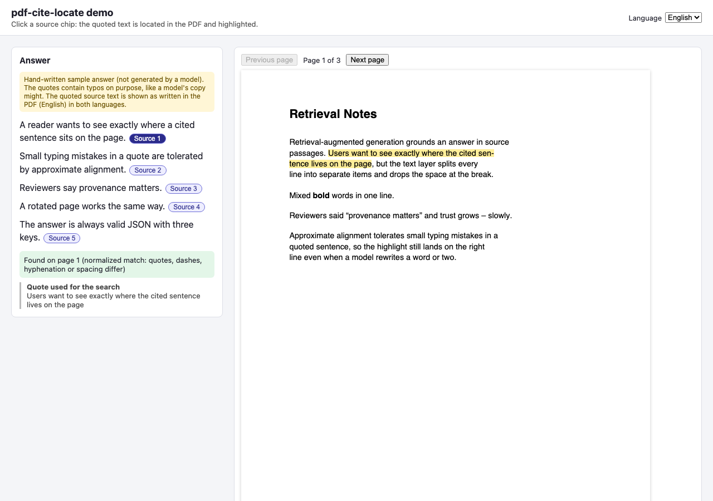
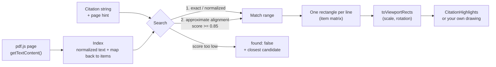
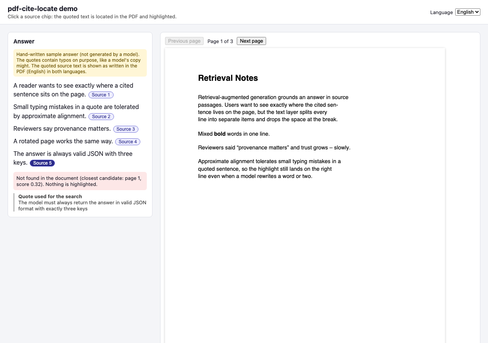
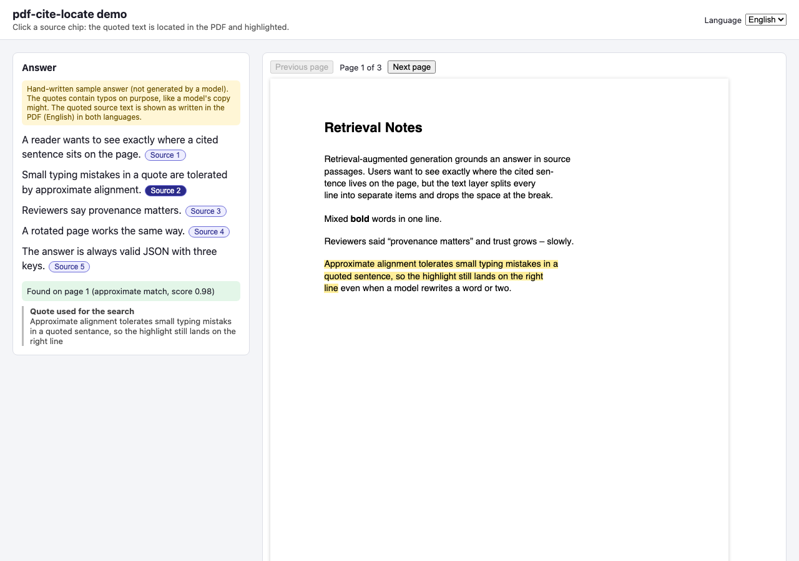
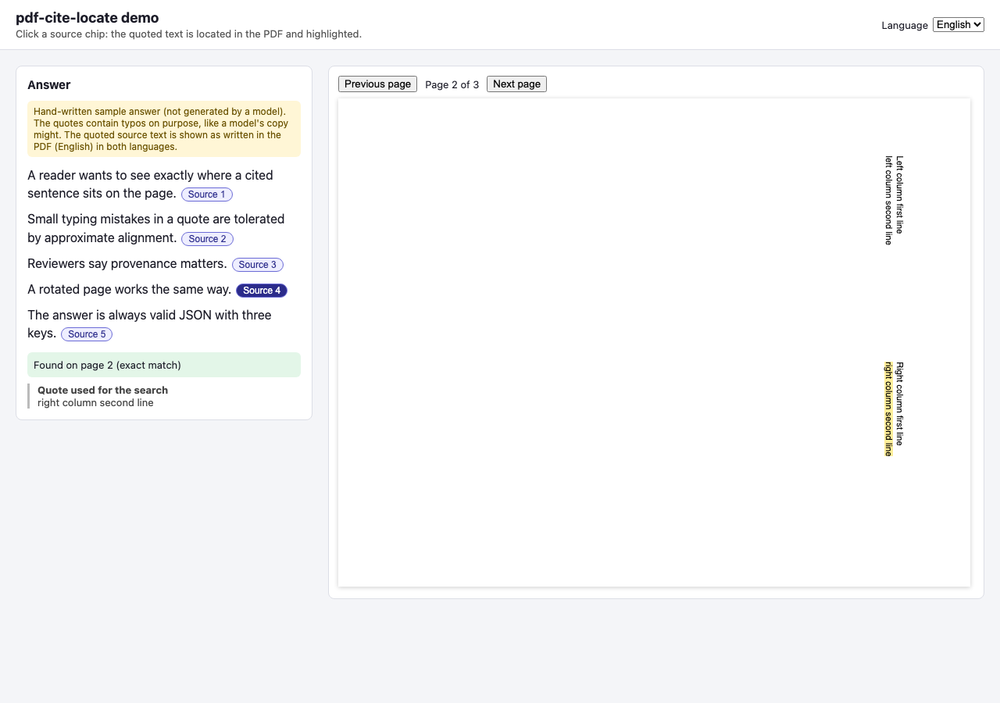
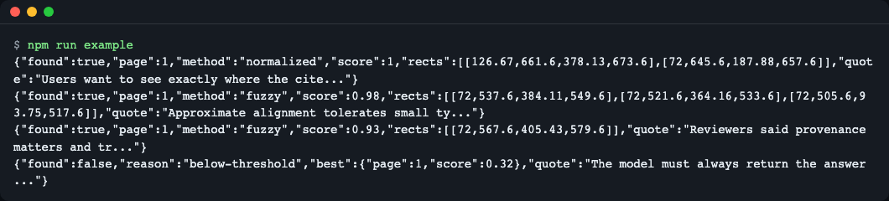

# pdf-cite-locate

**English** | [한국어](README.ko.md)

Find a RAG citation string inside a pdf.js page and get back highlight rectangles: it tolerates line-break hyphens, curly quotes and small typos, reports a score, and says "not found" instead of highlighting the wrong place. TypeScript, ESM, zero runtime dependencies, and it never imports `pdfjs-dist`, so it works with whatever pdf.js version your viewer already uses.



*The web example: click "Source 1" and the quoted sentence is highlighted on the PDF, across a hyphenated line break.*

## Why

A RAG answer says "source: page 3, this sentence". The PDF viewer (pdf.js) does not keep a page as one string. `page.getTextContent()` returns many small text items, one per line or font run, and the line break is only a flag (`hasEOL`), not a character. These are the first items of page 1 of the sample PDF (real output):

```text
{"str":"Retrieval Notes","x":72,"y":720,"hasEOL":false}
{"str":"","x":72,"y":680,"hasEOL":true}
{"str":"Retrieval-augmented generation grounds an answer in source","x":72,"y":680,"hasEOL":true}
{"str":"passages. Users want to see exactly where the cited sen-","x":72,"y":664,"hasEOL":true}
{"str":"tence lives on the page, but the text layer splits every","x":72,"y":648,"hasEOL":true}
```

Searching the quote `"the cited sentence lives on the page"` with a plain `includes()` fails: the sentence is split into `sen-` and `tence`, and there is no space at the break. A model that copies the quote may also change quotes or make a typo. This library joins the items, searches with exact, then normalized, then approximate matching, and maps the match back to the original items, so you get one rectangle per line.

## Install

```bash
npm install pdf-cite-locate
# or, straight from GitHub
npm install github:LeeGyeongPil/pdf-cite-locate
```

Node 22.13 or newer for Node use (that is what pdf.js 6 requires). The library has no runtime dependencies. `react` (18 or newer) is an optional peer dependency, only needed for `pdf-cite-locate/react`. You bring your own pdf.js (`pdfjs-dist`, or the copy that `react-pdf` installs).

## Quick start

Node, with the pdf.js legacy build (this is `examples/node/locate.mjs` in short):
> `fixtures/citations.pdf` ships with the GitHub repository, not the npm package: clone the repo (or point the path at your own PDF) to run this snippet as is.


```js
import { readFileSync } from "node:fs";
import * as pdfjs from "pdfjs-dist/legacy/build/pdf.mjs";
import { createLocator, toViewportRects } from "pdf-cite-locate";

const doc = await pdfjs.getDocument({
  data: new Uint8Array(readFileSync("fixtures/citations.pdf")),
  standardFontDataUrl: "node_modules/pdfjs-dist/standard_fonts/", // silences a font warning in Node
}).promise;

const locator = createLocator(doc);
const result = await locator.locate("Approximate alignment tolerates small typing mistaks in a quoted sentance", { pageHint: 1 });

if (result.found) {
  console.log(result.page, result.method, result.score.toFixed(2), result.approx);
  const page = await doc.getPage(result.page);
  console.log(toViewportRects(result.rects, page.getViewport({ scale: 1.5 })));
}
```

The quote has two typos on purpose ("mistaks", "sentance"). Real output of this snippet:

```text
1 fuzzy 0.97 true
[
  {
    left: 108,
    top: 363.5999999999999,
    width: 468.16200000000026,
    height: 18
  },
  {
    left: 108,
    top: 387.5999999999999,
    width: 113.3394827586207,
    height: 18
  }
]
```

`approx: true` means the x positions are estimated from character counts; see [Precision](#precision).

Browser with react-pdf (the full version is `examples/web/src/App.tsx`):

```tsx
import { Document, Page } from "react-pdf";
import { createLocator } from "pdf-cite-locate";
import { CitationHighlights } from "pdf-cite-locate/react";

// <Document onLoadSuccess={(pdf) => { locator = createLocator(pdf); }}> ... then, on a click:
const result = await locator.locate(quote, { pageHint: 1 });

<Page pageNumber={page} onLoadSuccess={(p) => setViewport(p.getViewport({ scale }))}>
  {viewport && result.found && <CitationHighlights rects={result.rects} viewport={viewport} page={page} />}
</Page>
```

## How it works



1. **Index.** Each text item is normalized character by character (Unicode NFKC, curly quotes and dashes unified, soft hyphens and zero-width characters dropped, spaces collapsed, case folded). A line that ends with `hasEOL` becomes one space, except that `sen-` + `tence` is glued into `sentence`. For every normalized character the index remembers which item and which character of that item it came from.
2. **Search.** First an exact search in the normalized text, then a search ignoring all spaces, then approximate alignment (Sellers edit distance, with 3-gram voting to pick a few candidate windows so long pages stay fast). The score is `1 - edit distance / quote length`. Below the threshold (default 0.85, quotes shorter than 12 characters never match approximately) the result is `found: false`.
3. **Rectangles.** The matched range is mapped back to items. Each item's transform matrix `[a, b, c, d, e, f]` gives the baseline direction and the glyph "up" direction, so rotated text works. Items on the same line are merged into one rectangle in PDF user space (y axis up).
4. **Viewport.** `toViewportRects` applies the viewport transform (scale, rotation, flipped y axis) and returns CSS pixels.

The pages are indexed lazily and cached. With a `pageHint`, the hint page is searched first, then its neighbours, then the rest, and if the hint page has an exact or normalized match no other page is even indexed.

## API

| Name | What it does | Arguments | Returns |
|---|---|---|---|
| `createLocator(doc, opts?)` | Wraps a pdf.js document (anything with `numPages` and `getPage(n)`). Indexes pages lazily and caches them. | `opts.measure?` a `Measurer`, `opts.textContentParams?` passed to `getTextContent` | `Locator` |
| `locator.locate(quote, opts?)` | Finds one quote. | `opts.pageHint?`, `opts.pages?`, `opts.threshold?` (0.85), `opts.caseSensitive?` (false) | `Promise<LocateResult>` |
| `locator.locateAll(quotes, opts?)` | Same, for a list of quotes. | `string[]`, `opts?` as in locate | `Promise<LocateResult[]>` |
| `locator.indexedPages()` | Which pages have been indexed so far. | none | `number[]` |
| `buildPageIndex(textContent, { pageNumber, measure? })` | Builds the index of one page. Use it when you already have the text content. | `TextContentLike` | `PageIndex` |
| `locateInIndexes(indexes, quote, opts?)` | Synchronous search over ready-made indexes. | `PageIndex[]`, quote, `LocateOptions` | `LocateResult` |
| `toViewportRects(rects, viewport)` | PDF user space to CSS pixels. | `PdfRect[]`, any object with a `transform` array (a pdf.js `PageViewport`) | `CssRect[]` (`left`, `top`, `width`, `height`) |
| `normalizeText(s)` | The normalization used for both sides. | `string` | `string` |
| `DEFAULT_THRESHOLD`, `MIN_FUZZY_LENGTH`, `BOX_ASCENT`, `BOX_DESCENT`, `VERSION` | Constants: 0.85, 12, box extent above and below the baseline (in font heights), package version. | | |
| `<CitationHighlights>` (`pdf-cite-locate/react`) | Absolutely positioned `role="mark"` boxes for one page. Put it inside the page container, for react-pdf as a child of `<Page>`. | `rects`, `viewport`, `page`, `color?`, `className?`, `label?`, `onSelect?(index)` | React element |
| `createCanvasMeasurer(styles)` (`pdf-cite-locate/dom`) | A `Measurer` that measures text with a canvas, like the pdf.js text layer does. | `textContent.styles` or `undefined` | `Measurer` |
| `LocateError` | Thrown for invalid input. `code` is `INVALID_TEXT_CONTENT`, `INVALID_PAGE` or `INVALID_OPTIONS`. | | |

`LocateResult` is one of:

```ts
{ found: true; page: number; score: number; method: "exact" | "normalized" | "fuzzy";
  matchedText: string; rects: PdfRect[]; approx: boolean }
{ found: false; reason: "below-threshold" | "no-text-layer" | "empty-quote";
  best?: { page: number; score: number; matchedText: string; rects: PdfRect[] } }
```

`PdfRect` is `{ page, x0, y0, x1, y1 }` in PDF user space.

### Error handling

Invalid input throws a `LocateError` whose message says how to fix it. `INVALID_PAGE` is thrown when `buildPageIndex` gets a `pageNumber` that is not an integer of 1 or more, when `createLocator` gets something that is not a pdf.js document, or when `locateInIndexes` gets something other than `PageIndex` objects. `INVALID_OPTIONS` is thrown when `locateAll` gets something that is not an array of strings (a single string, `null` or a number),, when `pages` is an empty array (no page to search) or `pageHint` is not a page number, and, from `createLocator` only, when `pages` has a page beyond the document (`locateInIndexes` does not check the upper bound). A page whose text is shorter than the quote length times the threshold cannot reach the threshold, so the approximate alignment skips it; this keeps a very long quote against short pages fast.

## Precision

Without a measurer, the start and end x of a rectangle are estimated by character count inside each text item, and the result has `approx: true`. That is usually within a fraction of the font size. In the browser, pass `createCanvasMeasurer(...)` to `createLocator`: x positions then come from measured glyph widths, rescaled to the item width the same way the pdf.js text layer does, and `approx` is `false`. How exact that is depends on the canvas font matching the PDF's font. Ligatures are expanded by pdf.js, so an item can have more characters than glyphs, which is a source of error for the estimate.

## Not found is a feature

If nothing reaches the threshold, you get `found: false` and, when there is one, the closest candidate in `best`. Do not highlight `best` as if it were a match. Show "not found in the document" and, if you like, offer the candidate as a hint. This is what happens with the hallucinated sentence in the sample: `npm run example` (see Examples) reports `score 0.32`, and the web example shows it like this:



*A quote that is not in the document: the message names the closest candidate and nothing is painted.*

Approximate matches stay useful. Source 2 has two typos and still lands on the right three lines:



*An approximate match: score 0.98, three line rectangles.*

Page 2 of the sample PDF is rotated by 90 degrees and has two columns. The rectangles come out in the right place because the viewport transform handles the rotation:



*Rotation: the highlight follows the rotated page.*

## Using with pdf.js versions

The core only needs a few members of the pdf.js objects (`numPages`, `getPage`, `getTextContent`, the viewport `transform`) and declares them as structural types. It does not import `pdfjs-dist`, and `pdfjs-dist` is not even a peer dependency. `react-pdf` pins its own exact `pdfjs-dist`, so listing it as a dependency here could install two copies with mismatched API and worker versions. The test suite runs the same fixture checks against `pdfjs-dist` 6.3.289 and 6.5.438 and gets the same page, method and matched text, and `npm run check:no-pdfjs-import` guards the rule. In the web example the worker is taken from the same `pdfjs-dist` that `react-pdf` uses.

## Examples

Node (precomputing coordinates, for example at indexing time):

```bash
npm run example
```

```text
{"found":true,"page":1,"method":"normalized","score":1,"rects":[[126.67,661.6,378.13,673.6],[72,645.6,187.88,657.6]],"quote":"Users want to see exactly where the cite..."}
{"found":true,"page":1,"method":"fuzzy","score":0.98,"rects":[[72,537.6,384.11,549.6],[72,521.6,364.16,533.6],[72,505.6,93.75,517.6]],"quote":"Approximate alignment tolerates small ty..."}
{"found":true,"page":1,"method":"fuzzy","score":0.93,"rects":[[72,567.6,405.43,579.6]],"quote":"Reviewers said provenance matters and tr..."}
{"found":false,"reason":"below-threshold","best":{"page":1,"score":0.32},"quote":"The model must always return the answer ..."}
```

Each line is one quote of `examples/node/quotes.json`; the rectangles are `[x0, y0, x1, y1]` in PDF points. Quote 1 is exact text across a hyphenated line break, so it needs the `normalized` method and returns two rectangles.



*The Node example in a terminal.*

Web (Vite + React + react-pdf, offline, English and Korean):

```bash
npm run example:web
```

Open the address that Vite prints. The language comes from `?lang=en|ko`, then from the menu choice saved in the browser, then from the browser language (Korean for `ko*`, otherwise English). The answer text and quotes in the page are a hand-written sample (not generated by a model); the quotes contain typos on purpose, as a model's copy might. `npm run example:build` builds the page into `examples/web/dist`.

## When to use it

- Good fit: you render PDFs with pdf.js or react-pdf and need rectangles for a citation string that a model returned, or you want to precompute `{page, rects}` per chunk in Node.
- Not covered: rendering PDFs, OCR (a scanned PDF returns `reason: "no-text-layer"`), choosing which passage to cite.

## Alternatives

Checked 2026-11-12 against the linked pages; these tools change, so read their current docs.

- **pdf.js find (`PDFFindController`)**: built into the pdf.js viewer ([pdf.js](https://github.com/mozilla/pdf.js)). It is a search bar that matches text and highlights it in the DOM. It needs the viewer and its event bus, and it does not hand you coordinates as data. If you want the stock viewer's search box, use it.
- **react-pdf `customTextRenderer`**: lets you rewrite the string of each text-layer item ([react-pdf](https://github.com/wojtekmaj/react-pdf)). It works per item. Finding a phrase that spans several items or lines is not provided; see [issue 1827](https://github.com/wojtekmaj/react-pdf/issues/1827).
- **LiteParse `searchItems`**: finds phrases in the text items of LiteParse's own parser output and returns coordinates ([LiteParse](https://github.com/run-llama/liteparse), [guide](https://developers.llamaindex.ai/liteparse/guides/visual-citations/index.md)). That is a different parser from the browser pdf.js text layer, so items and coordinates differ, and it does not do approximate alignment or return a score.
- **Commercial viewers and hosted citation services** (for example [MuPDF WebViewer](https://webviewer-docs.mupdf.com/ai)): can map a model's citation to page rectangles, but tie you to that viewer or send documents to a paid service.

## Limitations

- Reading order is the content stream order. On multi-column pages an approximate match can be misled across columns.
- A quote that spans two pages, an ellipsis-truncated quote, and per-character precision through DOM ranges are not supported yet.
- Without a measurer, x positions are estimates (`approx: true`).

## Versioning and compatibility

[SemVer](https://semver.org/). While the version is 0.x, minor versions may change the API; changes are listed in [CHANGELOG.md](CHANGELOG.md). Checked with `pdfjs-dist` 6.3.289 and 6.5.438, `react-pdf` 11.0.0, React 19.3.1, TypeScript 7.0.2, Node 26.13 (CI uses Node 24).

## Development

```bash
npm install
npm test
npm run typecheck
npm run build
npm run check:no-pdfjs-import
```

## License

MIT. pdf.js (Apache-2.0) is not bundled; it is a dev dependency used by tests and examples only.
